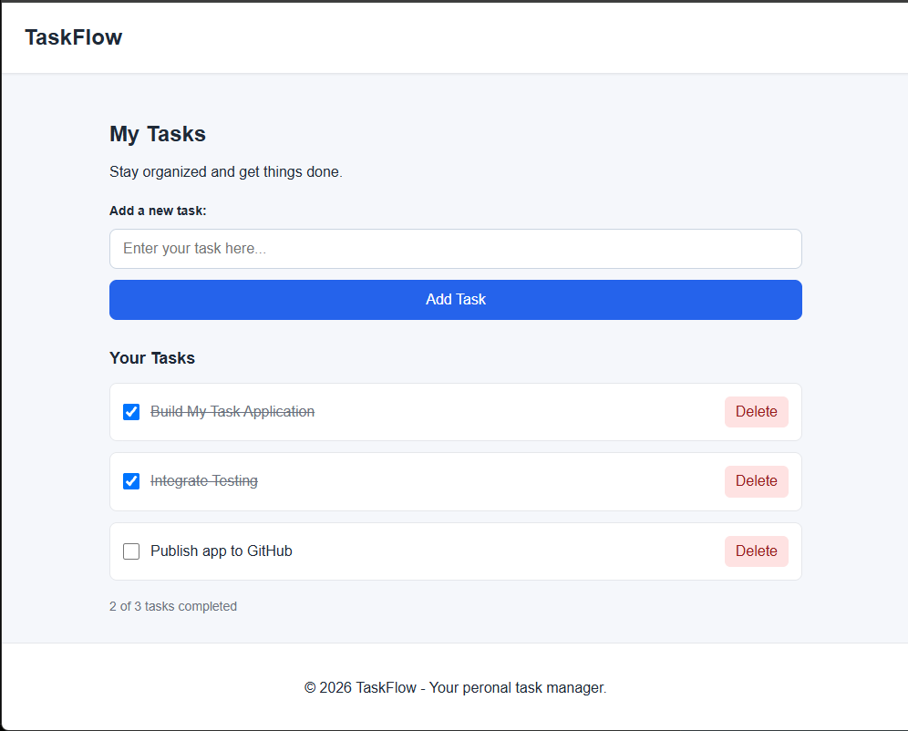

# TaskFlow — Task Management Application

A responsive task management application built with **HTML5, CSS3, and vanilla JavaScript**. TaskFlow helps users organize daily activities, track completed tasks, and preserve their progress using browser local storage.

## Screenshots

## Features

- **Task management:** Add, complete, and delete tasks dynamically.
- **Progress tracking:** Display the number of completed tasks and total tasks.
- **Persistent storage:** Preserve task data across browser refreshes using `localStorage`.
- **Input validation:** Validate task descriptions and display helpful error messages.
- **Error handling:** Provide feedback when changes cannot be saved.
- **Responsive design:** Support desktop, tablet, and mobile layouts.
- **Accessibility:** Use semantic HTML, associated form labels, keyboard-accessible controls, and accessible feedback.
- **Empty state:** Display a helpful message when no tasks are available.

## Technologies Used

- HTML5
- CSS3
- JavaScript (ES6+)
- BEM methodology
- DOM API
- Web Storage API (`localStorage`)
- Git and GitHub
- GitHub Pages

## Project Architecture

TaskFlow separates application responsibilities into JavaScript modules:

- `scripts/index.js` — Manages application state, event handlers, task operations, and UI updates.
- `scripts/task.js` — Creates task elements and handles interactions through callbacks.
- `scripts/storage.js` — Validates stored data, loads tasks, and saves changes.

CSS is organized using the BEM naming methodology, with stylesheets grouped by component.

## Getting Started

1. Clone the repository to your computer.
2. Open the project folder in Visual Studio Code.
3. Run `index.html` using Live Server, or serve the project using another local HTTP server.
4. Open TaskFlow in your browser.

The application requires no backend server or database installation.

## How to Use

1. Enter a task description in the input field.
2. Click **Add Task** to create a new task.
3. Check a task's checkbox to mark it as completed.
4. Click **Delete** to remove a task.
5. Refresh the page to verify that changes remain saved.

## Data Storage

TaskFlow stores task data in the browser using `localStorage`.

Data is specific to each browser and website origin. Tasks are not synchronized across devices or user accounts.

## Testing

Manual functional and regression checks cover task creation, completion, deletion, validation, storage recovery, responsiveness, and keyboard interaction.

Automated unit tests are planned for a future update.

## Future Improvements

- Automated unit and integration tests.
- Task editing and filtering.
- Task sorting and prioritization.
- Optional backend integration for synchronized storage.

## Author

Daniel Quintana

Software Engineering Portfolio Project
